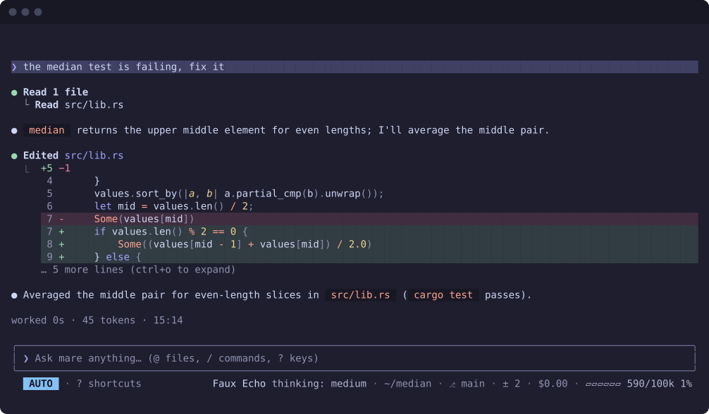

<div align="center">

<p>
  
  
</p>

<p><strong>高度に拡張できるエージェントハーネス。</strong></p>

<p>
  <a href="docs/ja/get-started/overview.md">ドキュメント</a> ·
  <a href="docs/ja/get-started/quickstart.md">クイックスタート</a> ·
  <a href="https://signalridge.github.io/mare/ja/">サイト</a> ·
  <a href="README.md">English</a> ·
  <a href="README.zh-CN.md">简体中文</a> ·
  <strong>日本語</strong>
</p>

<p>
  
</p>

<p><sub>実際の TUI をオフラインのスクリプト化モデルで記録した画面です。</sub></p>

</div>

mare の中心は、プロセスを制限し、セッションを確実に保存し、`mare-tui` でターミナル UI を描画し、プラグインを動かす小さな Rust カーネルです。エージェントループ、ツール、モデルプロバイダー、コンパクション、権限ポリシー、ステータスライン、UI コンポーネントとテーマは [cordis-lua](https://github.com/signalridge/cordis-lua) 上の Lua 5.5 プラグインとして実装されています。

## 主な特徴

- **組み込みとユーザープラグイン**: 組み込みプラグインも自作プラグインと同じ公開 Cordis サービス・イベント API で動作します。`mare runtime` で組み込みソースを確認し、置き換えるには優先度の高いソースに同名定義を置いて `override = true` を設定し、`/reload` を実行します。
- **Rust による安全境界**: OS サンドボックス (Linux の bubblewrap / Landlock、macOS の Seatbelt、Windows の制限付きトークンと任意の強化層)、プロジェクト信頼、クラッシュ耐性のある JSONL セッション、編集前スナップショット (`/rewind`)、Lua ウォッチドッグを Rust 側で担保します。
- **Lua による設定**: `~/.config/mare/init.lua` と信頼済みプロジェクトの `.mare/init.lua` をサポート。`mare init` が LuaLS 型定義を設定し、`mare.plugins.add` と `mare-lock.json` でパッケージを管理し、`mare --clean` で素の起動もできます。
- **1 つのセッションモデルを複数フロントエンドで**: 通常スクロールバックを保つメイン画面 TUI、スクリプト・CI 向けの `-p` / `--json`、双方向 mare RPC プロトコル 3.0 (`--rpc`)、認証付き `--web` HTTP/WebSocket RPC、エディター向け ACP (`mare acp`)。

## クイックスタート

**1. インストール。** ワンラインインストーラーや各種パッケージマネージャー (`brew`、`scoop`、`nix`、`yay`、Docker/GHCR) で導入するか、[GitHub Releases](https://github.com/signalridge/mare/releases) から `.deb` / `.rpm` パッケージまたは `.tar.gz` / `.zip` アーカイブを取得できます ([インストール手順](docs/ja/get-started/installation.md))。Rust 1.100.0+ と C コンパイラーでソースからビルドすることもできます。

```sh
# macOS / Linux ワンラインインストール (SHA-256 検証付き)
curl -fsSL https://signalridge.github.io/mare/install.sh | sh

# Homebrew (macOS / Linux)
brew tap signalridge/tap && brew trust signalridge/tap
brew install signalridge/tap/mare

# Nix (Flake / NUR)
nix run github:signalridge/mare
nix profile install github:signalridge/nur-packages#mare

# Arch Linux (AUR) & コンテナ (GHCR)
yay -S mare-bin
docker run --rm -it -v "$PWD:/workspace" -w /workspace ghcr.io/signalridge/mare:latest
```

```powershell
# Windows ワンラインインストール (PowerShell, SHA-256 検証付き)
irm https://signalridge.github.io/mare/install.ps1 | iex

# Scoop (Windows)
scoop bucket add signalridge https://github.com/signalridge/scoop-bucket
scoop install signalridge/mare
```

```sh
# ソースから Cargo でインストール (または clone してビルド)
cargo install --git https://github.com/signalridge/mare --locked --bin mare mare-cli
```

**2. 起動。** プロジェクトディレクトリでそのまま `mare` を実行します。認証情報が未設定なら、初回オンボーディングが自動で始まり、プロバイダーのログイン・既定モデル・任意プラグインを選択できます。

```sh
cd ~/src/my-project
mare
```

`mare init`、`mare login openai` (または `--with-api-key` で標準入力から API キーを渡す)、`mare doctor` で明示的に準備することもできます。

**3. 設定 (`~/.config/mare/init.lua`)。** [mare-plugins](https://github.com/signalridge/mare-plugins) の拡張を導入したり、[cordis-lua](https://github.com/signalridge/cordis-lua) ベースで独自プラグインを書いたりできます。

```lua
mare.setup { model = "openai/gpt-6.1-terra" }
mare.plugin("tools", { bash_timeout_ms = 120000 })

mare.plugins.add {
  { "signalridge/mare-plugins", version = "^1" },
}
```

## ドキュメント

| トピック | リンク |
|---|---|
| ドキュメント目次 | [docs/README.md（多言語目次）](docs/README.md) · [signalridge.github.io/mare](https://signalridge.github.io/mare/ja/) |
| はじめに・実践 | [クイックスタート](docs/ja/get-started/quickstart.md) · [インストール](docs/ja/get-started/installation.md) · [ワークフロー](docs/ja/get-started/workflows.md) |
| 設定・拡張 | [init.lua](docs/ja/configure/files.md) · [パッケージ](docs/ja/configure/packages.md) · [プラグインを書く](docs/ja/extend/writing-a-plugin.md) |
| 安全性・連携 | [権限とサンドボックス](docs/ja/use/permissions.md) · [RPC](docs/ja/integrate/rpc.md) · [ACP](docs/ja/integrate/acp.md) · [ヘッドレス](docs/ja/use/headless.md) |
| アーキテクチャ・リファレンス | [サブシステム（英語）](docs/subsystems/README.md) · [CLI](docs/ja/reference/cli.md) · [Lua API](docs/ja/extend/lua-api.md) · [RPC リファレンス](docs/ja/reference/rpc.md) |
| リリース・ガバナンス | [NEWS.md（英語）](crates/mare-plugin/preset/NEWS.md) · [SECURITY.md（英語）](SECURITY.md) · [CONTRIBUTING.md（英語）](CONTRIBUTING.md) |

## 謝辞

mare の設計と実装は以下のプロジェクトの知見に支えられています。

- [DeepSeek Harness](https://github.com/deepseek-ai/deepseek-harness) & [Cordis](https://github.com/cordiverse/cordis): サービス、イベント、差し替え可能なエージェントループによるプラグイン中心の設計。
- [Codex](https://github.com/openai/codex): プロセス実行、OS サンドボックス、`apply_patch`、Rust 基盤。
- [Kimi Code](https://github.com/MoonshotAI/kimi-code): コンテキスト復元のフッター設計および機密情報のリダクションパターン。
- [pi](https://github.com/earendil-works/pi-mono): コンパクション要約プロンプト、リトライ時のエラー分類、プロジェクト信頼フロー。
- [Neovim](https://neovim.io/): `init.lua` 設定モデル、型付き Lua API、RPC 設計。
- [Yazi](https://yazi-rs.github.io/) & [WezTerm](https://wezterm.org/): Rust アプリ向け Lua プラグイン・パッケージ構成と再起動不要のコード設定。

名前は月の海 (lunar maria) に由来します。コアが月で、プラグインがその表面に広がる海です。

## ライセンス

[Apache License, Version 2.0](LICENSE) の下で公開されています。サードパーティの著作権表示と通知は [THIRD_PARTY_NOTICES.md](THIRD_PARTY_NOTICES.md) を参照してください。
