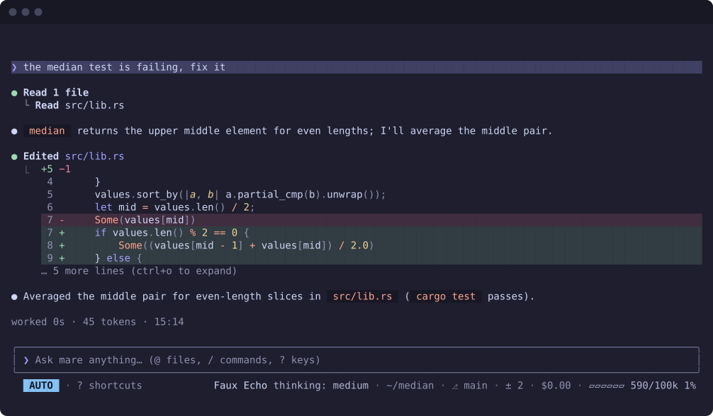

<div align="center">

<p>
  
  
</p>

<p><strong>可高度扩展的 agent harness。</strong></p>

<p>
  <a href="docs/zh/get-started/overview.md">文档</a> ·
  <a href="docs/zh/get-started/quickstart.md">快速上手</a> ·
  <a href="https://signalridge.github.io/mare/zh/">官网</a> ·
  <a href="README.md">English</a> ·
  <strong>简体中文</strong> ·
  <a href="README.ja.md">日本語</a>
</p>

<p>
  
</p>

<p><sub>由真实 TUI 对接离线脚本化模型录制而成。</sub></p>

</div>

mare 的核心是一个精简的 Rust 内核，负责约束进程、保证会话持久、通过 `mare-tui` 渲染终端界面并运行插件。agent 循环、工具、模型 provider、上下文压缩、权限策略、状态栏以及 UI 组件与主题都是基于 [cordis-lua](https://github.com/signalridge/cordis-lua) 构建的 Lua 5.5 插件。

## 核心特性

- **内置与用户插件**：内置插件与用户插件共用同一套公开的 Cordis 服务与事件 API。运行 `mare runtime` 查看内置插件源码；要替换某个插件，可在更高优先级的来源中提供同名定义，设置 `override = true`，然后运行 `/reload`。
- **Rust 安全边界**：操作系统沙箱（Linux 的 bubblewrap 或 Landlock、macOS 的 Seatbelt、Windows 受限令牌及可选增强层级）、项目信任、崩溃安全的 JSONL 会话、写前文件快照（`/rewind`）与 Lua 看门狗都由 Rust 保障。
- **Lua 配置即代码**：支持 `~/.config/mare/init.lua` 与受信任项目的 `.mare/init.lua`，`mare init` 生成 LuaLS 类型配置，内置 git 包管理（`mare.plugins.add` 与 `mare-lock.json`）及 `mare --clean`。
- **多端统一会话模型**：主屏原生滚动 TUI、面向脚本与 CI 的无界面 `-p` / `--json`、双向 mare RPC 协议 3.0（`--rpc`）、带认证的 `--web` HTTP/WebSocket RPC 服务，以及面向编辑器的 ACP（`mare acp`）。

## 快速开始

**1. 安装。** 可使用一键安装脚本、包管理器（`brew`、`scoop`、`nix`、`yay`、Docker/GHCR），从 [GitHub Releases](https://github.com/signalridge/mare/releases) 下载 `.deb` / `.rpm` 安装包或 `.tar.gz` / `.zip` 压缩包（详见[安装指南](docs/zh/get-started/installation.md)），或使用 Rust 1.100.0+ 与 C 编译器从源码编译：

```sh
# macOS / Linux 一键安装（自动校验 SHA-256）
curl -fsSL https://signalridge.github.io/mare/install.sh | sh

# Homebrew (macOS / Linux)
brew tap signalridge/tap && brew trust signalridge/tap
brew install --cask mare

# Nix (Flake / NUR)
nix run github:signalridge/mare
nix profile install github:signalridge/nur-packages#mare

# Arch Linux (AUR) 与容器 (GHCR)
yay -S mare-bin
docker run --rm -it -v "$PWD:/workspace" -w /workspace ghcr.io/signalridge/mare:latest
```

```powershell
# Windows 一键安装（PowerShell，自动校验 SHA-256）
irm https://signalridge.github.io/mare/install.ps1 | iex

# Scoop (Windows)
scoop bucket add signalridge https://github.com/signalridge/scoop-bucket
scoop install signalridge/mare
```

```sh
# 从源码通过 Cargo 安装（或 git clone 后手动构建）
cargo install --git https://github.com/signalridge/mare --locked --bin mare mare-cli
```

**2. 直接启动。** 在项目目录运行 `mare`。若尚未配置任何模型凭据，交互界面会自动进入首次引导（选择 provider、登录、默认模型与可选插件）：

```sh
cd ~/src/my-project
mare
```

也可以手动执行 `mare init`、`mare login openai`（或通过 `--with-api-key` 从标准输入导入 API Key）与 `mare doctor`。

**3. 配置（`~/.config/mare/init.lua`）。** 通过 [mare-plugins](https://github.com/signalridge/mare-plugins) 扩展功能，或基于 [cordis-lua](https://github.com/signalridge/cordis-lua) 编写自己的插件：

```lua
mare.setup { model = "openai/gpt-6.1-terra" }
mare.plugin("tools", { bash_timeout_ms = 120000 })

mare.plugins.add {
  { "signalridge/mare-plugins", version = "^1" },
}
```

## 文档导航

| 主题 | 链接 |
|---|---|
| 文档总览 | [docs/README.md（多语言索引）](docs/README.md) · [signalridge.github.io/mare](https://signalridge.github.io/mare/zh/) |
| 入门与工作流 | [快速上手](docs/zh/get-started/quickstart.md) · [安装指南](docs/zh/get-started/installation.md) · [常见工作流](docs/zh/get-started/workflows.md) |
| 配置与扩展 | [init.lua](docs/zh/configure/files.md) · [包管理](docs/zh/configure/packages.md) · [编写插件](docs/zh/extend/writing-a-plugin.md) |
| 安全与集成 | [权限与沙箱](docs/zh/use/permissions.md) · [RPC](docs/zh/integrate/rpc.md) · [ACP](docs/zh/integrate/acp.md) · [无界面模式](docs/zh/use/headless.md) |
| 架构与参考 | [子系统架构（英文）](docs/subsystems/README.md) · [CLI](docs/zh/reference/cli.md) · [Lua API](docs/zh/extend/lua-api.md) · [RPC 参考](docs/zh/reference/rpc.md) |
| 版本与治理 | [NEWS.md（英文）](crates/mare-plugin/preset/NEWS.md) · [SECURITY.md（英文）](SECURITY.md) · [CONTRIBUTING.md（英文）](CONTRIBUTING.md) |

## 致谢

mare 的设计与实现得益于以下开源项目：

- [DeepSeek Harness](https://github.com/deepseek-ai/deepseek-harness) 与 [Cordis](https://github.com/cordiverse/cordis)：一切皆插件的服务、事件与可替换 agent 循环架构。
- [Codex](https://github.com/openai/codex)：进程执行、操作系统沙箱、`apply_patch` 与 Rust 基础设施。
- [Kimi Code](https://github.com/MoonshotAI/kimi-code)：上下文恢复尾注与日志/密钥脱敏规则。
- [pi](https://github.com/earendil-works/pi-mono)：上下文压缩摘要提示词、重试错误分类与项目信任流程。
- [Neovim](https://neovim.io/)：`init.lua` 配置模型、带类型的 Lua API 与 RPC 设计。
- [Yazi](https://yazi-rs.github.io/) 与 [WezTerm](https://wezterm.org/)：Rust 应用中的 Lua 插件/包组织方式与热重载配置即代码。

名字取自月海（lunar maria）：核心是月球，插件是月面上的海。

## 许可证

采用 [Apache License 2.0](LICENSE) 许可协议。第三方归属与声明见 [THIRD_PARTY_NOTICES.md](THIRD_PARTY_NOTICES.md)。
